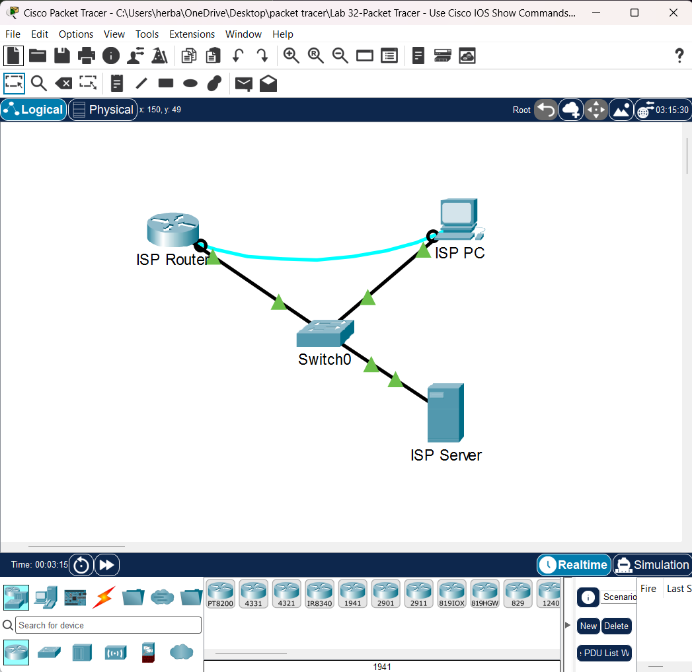

## Overview

Explore the operational information available from a Cisco 4321 router at an ISP. Use terminal access and Cisco IOS `show` commands to inspect interfaces, addressing, routing, software, and the running configuration.

<!--more-->

---

## Preconditions

---

## Skills Practiced

- Connect to a router using a terminal session
- Distinguish user EXEC and privileged EXEC access
- Interpret router interfaces, routes, ARP entries, and IOS information

---

## Completed Lab Documentation

- Note: [Completed Lab PDF may be available upon request]

---

## Key Observations

The `show` command family gives network administrators a read-only view of device state. Comparing interface status, addressing, routes, and installed software provides a foundation for troubleshooting.

### Activity Focus

1. Access the ISP router from the connected PC and identify the CLI prompt.
2. Explore `show arp`, `show flash`, `show ip route`, and `show interfaces`.
3. Review `show ip interface`, `show version`, `show protocols`, and `show running-config` in the appropriate EXEC mode.

### Notes

A physical interface can be administratively down, operationally down, or up/up; these states mean different things.

---

## Validation

Confirm the expected active interface, directly connected routes, and router software details from command output.

---
---
---

## 🔗 Navigation

* [Home](/)
* [Network+ Portfolio](/network-portfolio/)
  * **[FORMATIVE MODULES](/network-portfolio/formative-modules/)**
  * [Videos](/network-portfolio/videos/)
  * [Study Diagrams](/network-portfolio/study-diagrams/)
* [Trading+](/trading/)
* [Bible Study](/bible-study/)
* [About the Portfolio](/about/)

---
---
---
