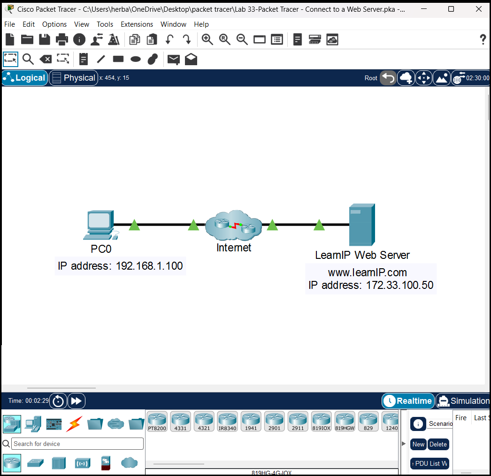

## Overview

Verify that a Packet Tracer client can reach a web server at `172.33.100.50`, then access the website directly by IP address. Compare basic network reachability with a working application-layer connection.

<!--more-->

---

## Preconditions

---

## Skills Practiced

- Test reachability with `ping`
- Open a web page using a server IPv4 address
- Differentiate ICMP reachability from web service access

---

## Completed Lab Documentation

- Note: [Completed Lab PDF may be available upon request]

---

## Key Observations

A successful ICMP reply demonstrates IP reachability, while loading the website also demonstrates that the web client and server application are functioning. An initial ping may time out while address resolution occurs.

### Activity Focus

1. Use PC0 to send an ICMP echo request to `172.33.100.50`.
2. Examine the replies and packet-loss summary.
3. Open the Packet Tracer browser and reach the web page by IP address.

### Notes

The completed worksheet displays an initial timeout in the ping transcript and the “Welcome to the Learn IP Web Site” page.

---

## Validation

Verify the server responds to ping and the expected web page loads.

---
---
---

## 🔗 Navigation

* [Home](/)
* [Network+ Portfolio](/network-portfolio/)
  * **[FORMATIVE MODULES](/network-portfolio/formative-modules/)**
  * [Video Walkthroughs](/network-portfolio/videos/)
  * [Study Diagrams](/network-portfolio/study-diagrams/)
* [Trading+](/trading/)
* [Bible Study](/bible-study/)
* [About the Portfolio](/about/)

---
---
---
