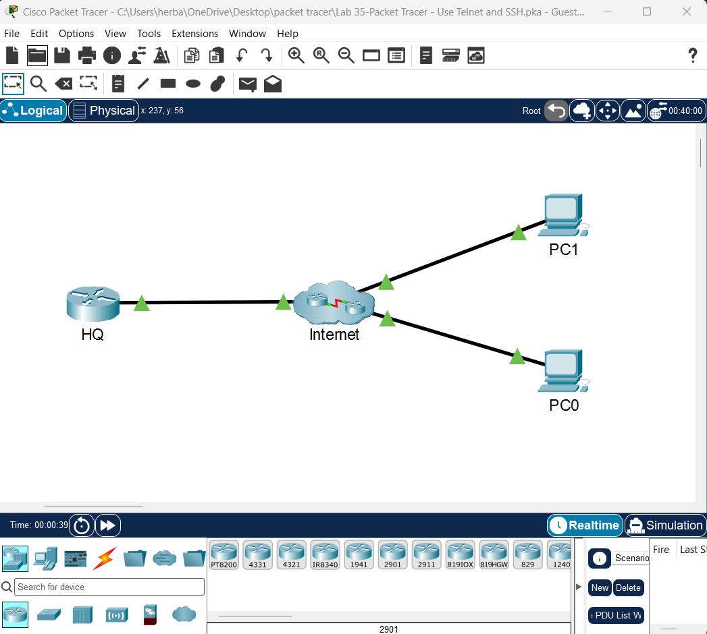

## Overview

Verify DHCP addressing and connectivity to router HQ at `64.100.1.1`, then compare the results of Telnet and SSH connection attempts. Observe how a router can reject insecure remote access while permitting SSH.

<!--more-->

---

## Preconditions

---

## Skills Practiced

- Inspect DHCP-assigned host settings
- Test IP connectivity before remote access
- Compare Telnet with encrypted SSH management

---

## Video Walkthrough

This lab is documented as a written exercise; no video walkthrough is planned.


<iframe width="560" height="315" src="https://www.youtube.com/embed/{{ page.video_id }}" title="{{ page.title }}" frameborder="0" allowfullscreen></iframe>


---

## Completed Lab Documentation

- Note: [Completed Lab PDF may be available upon request]

---

## Key Observations

The completed lab records a closed Telnet connection and successful SSH access to the `HQ#` prompt. Network reachability and management-service authorization are separate checks.

### Activity Focus

1. Verify the PC address with `ipconfig /all` and ping the HQ router.
2. Attempt a Telnet connection and observe its result.
3. Use the Packet Tracer SSH client to connect to the router.

### Notes

SSH is preferred to Telnet for remote CLI administration because SSH encrypts the session.

---

## Validation

Confirm the router is reachable, Telnet access is refused, and the SSH session reaches the expected prompt.

---
---
---

## 🔗 Navigation

* [Home](/)
* [Network+ Portfolio](/network-portfolio/)
  * **[FORMATIVE MODULES](/network-portfolio/formative-modules/)**
  * [Video Walkthroughs](/network-portfolio/videos/)
  * [Study Diagrams](/network-portfolio/study-diagrams/)
* [Trading+](/trading/)
* [Bible Study](/bible-study/)
* [About the Portfolio](/about/)

---
---
---
