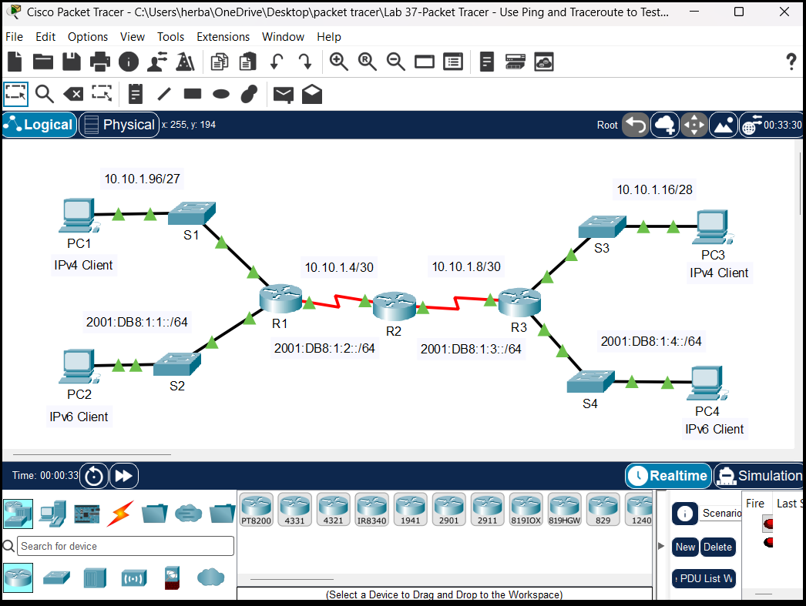

## Overview

Diagnose connectivity problems across a three-router topology serving IPv4 and IPv6 hosts. Collect host addressing, compare ping and traceroute results, inspect router interfaces and routing information, and restore connectivity.

<!--more-->

---

## Preconditions

---

## Skills Practiced

- Identify the last reachable hop in a failing route
- Troubleshoot IPv4 and IPv6 separately
- Verify router interfaces and network reachability after repairs

---

## Video Walkthrough

This lab is documented as a written exercise; no video walkthrough is planned.


<iframe width="560" height="315" src="https://www.youtube.com/embed/{{ page.video_id }}" title="{{ page.title }}" frameborder="0" allowfullscreen></iframe>


---
## Completed Lab Documentation

- Note: [Completed Lab PDF may be available upon request]

---

## Key Observations

Traceroute reveals the progression of packets toward a destination, while ping confirms reachability. Together with router CLI outputs, these tests help separate host, interface, and routing problems.

### Activity Focus

1. Collect host IP configuration and establish a baseline with ping.
2. Trace the path from both ends of a failed connection.
3. Inspect router interfaces and routing information, then validate the repaired path.

### Notes

The completed worksheet includes separate parts for restoring IPv4 and IPv6 connectivity.

---

## Validation

Confirm PC1-to-PC3 IPv4 reachability and PC2-to-PC4 IPv6 reachability after troubleshooting.

---
---
---

## 🔗 Navigation

* [Home](/)
* [Network+ Portfolio](/network-portfolio/)
  * **[FORMATIVE MODULES](/network-portfolio/formative-modules/)**
  * [Video Walkthroughs](/network-portfolio/videos/)
  * [Study Diagrams](/network-portfolio/study-diagrams/)
* [Trading+](/trading/)
* [Bible Study](/bible-study/)
* [About the Portfolio](/about/)

---
---
---

