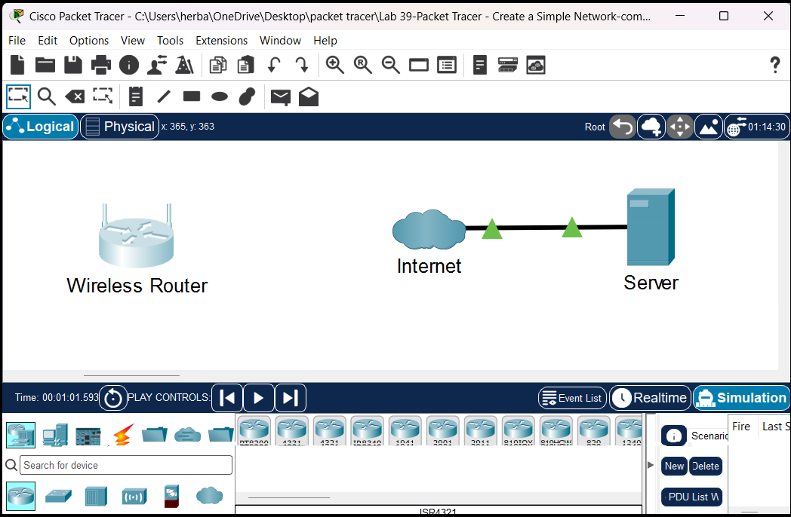

## Overview

Build a small home-style network in Cisco Packet Tracer with a wired PC, wireless laptop, wireless router, cable modem, and Internet cloud. Configure host connectivity, install a wireless laptop adapter, and verify access to `cisco.pka`.

<!--more-->

---

## Preconditions

---

## Skills Practiced

- Place and connect devices in the Packet Tracer workspace
- Select appropriate copper and coaxial connections
- Configure a wired DHCP client and a wireless laptop adapter
- Validate connectivity using IP settings, ping, and a browser

---

## Video Walkthrough


<iframe width="560" height="315" src="https://www.youtube.com/embed/{{ page.video_id }}" title="{{ page.title }}" frameborder="0" allowfullscreen></iframe>


---

## Completed Lab Documentation

- Note: [Completed Lab PDF may be available upon request]

---

## Key Observations

A working network depends on both physical connectivity and correct end-device configuration. This exercise brings together device placement, cabling, DHCP, wireless association, and end-to-end validation.

### Activity Focus

1. Add the PC, laptop, and cable modem, then connect them to the existing router and Internet cloud.
2. Check the PC DHCP lease and test `cisco.pka`.
3. Replace the laptop Ethernet module with WPC300N, join `HomeNetwork`, and test browser access.

### Notes

This is the selected video walkthrough lab. The YouTube video ID and completed PDF path are intentionally blank until the recording and export are ready.

---

## Validation

Confirm the wired PC receives an address in the expected 192.168.0.x range, can ping `cisco.pka`, and the wireless laptop can browse to the site.

---
---
---

## 🔗 Navigation

* [Home](/)
* [Network+ Portfolio](/network-portfolio/)
  * **[FORMATIVE MODULES](/network-portfolio/formative-modules/)**
  * [Video Walkthroughs](/network-portfolio/videos/)
  * [Study Diagrams](/network-portfolio/study-diagrams/)
* [Trading+](/trading/)
* [Bible Study](/bible-study/)
* [About the Portfolio](/about/)

---
---
---
