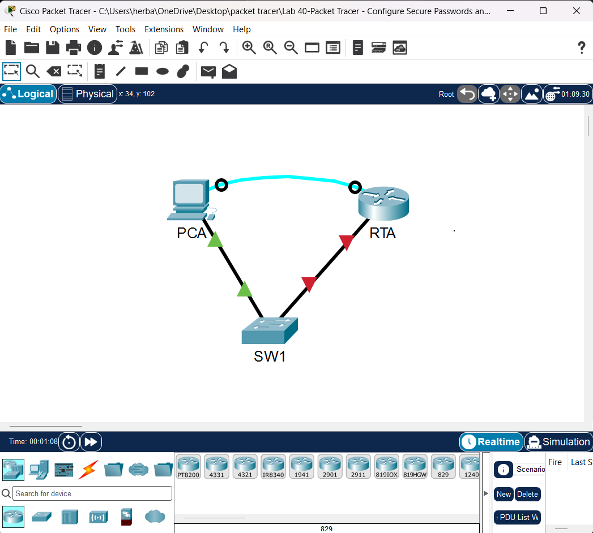

## Overview

In this Cisco Packet Tracer lab, I prepared a router (**RTA**) and switch (**SW1**) for deployment by applying basic device security controls. I configured IPv4 management addressing, privileged access protection, local user authentication, SSH-only remote access, login restrictions, and session timeouts. I also disabled unused switch ports and reviewed the security configurations.

This lab reinforced the importance of securing network devices **during initial configuration**, rather than treating security as a final step.

<!--more-->

---

## Preconditions

- Cisco Packet Tracer activity with router **RTA**, switch **SW1**, and workstation **PCA**
- Console access to RTA and CLI access to SW1
- Lab addressing requirements and instructions

| Device | Interface | IPv4 address | Subnet mask | Default gateway |
| --- | --- | --- | --- | --- |
| RTA | G0/0 | `172.16.1.1` | `255.255.255.0` | N/A |
| PCA | NIC | `172.16.1.10` | `255.255.255.0` | `172.16.1.1` |
| SW1 | VLAN 1 | `172.16.1.2` | `255.255.255.0` | `172.16.1.1` |



---

## Skills Practiced

- Configuring router and switch IPv4 management interfaces
- Protecting privileged EXEC access with `enable secret`
- Configuring password policies and local user accounts
- Generating RSA keys and enabling SSH remote administration
- Restricting VTY access to SSH with local authentication
- Configuring login attempt restrictions and inactivity timeouts
- Disabling unused switch interfaces with `interface range`
- Saving configurations and checking device security settings

---

## Watch the Video Walkthrough


<iframe width="560" height="315" src="https://www.youtube.com/embed/{{ page.video_id }}" title="{{ page.title }}" frameborder="0" allowfullscreen></iframe>


---

## Completed Lab Documentation

- Note: *Completed Lab PDF may be available upon request.*

---

## Lab Steps

1. **Configure PCA and RTA:** Assign IPv4 addresses, enable RTA G0/0, and set the router hostname.
2. **Secure the router:** Configure password protection, a minimum password length, local credentials, a domain name, and RSA keys.
3. **Restrict router access:** Configure login attempt blocking, SSH-only VTY access, local authentication, and a six-minute EXEC timeout. Save the configuration.
4. **Test router SSH access:** From PCA, connect to `172.16.1.1` using the configured local username. The completed lab documents a successful SSH login to `RTA>`.
5. **Configure SW1:** Assign its VLAN 1 management address and default gateway; disable unused ports using `interface range` and `shutdown`.
6. **Secure the switch:** Configure privileged access, local authentication, RSA keys, SSH-only VTY access, and a six-minute EXEC timeout. Save the configuration.
7. **Review security settings:** Check interface status, SSH configuration, local access restrictions, and saved settings.

---

## Validation

The completed lab documents a successful SSH session from PCA to RTA. Its final section also identifies verification commands for both devices:

```text
show running-config
show ip interface brief
show ip ssh
show users
show startup-config
```

For switch port status:

```text
show interfaces status
```

These commands help verify addressing, SSH availability, VTY restrictions, administratively disabled ports, and saved configuration. The PDF lists these verification checks but does not record output for every command.

---

## Troubleshooting / Notes

- SSH requires a hostname, domain name, local credentials, and RSA keys on the devices used in this activity.
- `transport input ssh` prevents Telnet access on the configured VTY lines; `login local` authenticates against local user accounts.
- The lab specifies **1024-bit RSA keys** for Packet Tracer scoring. Modern production deployments should generally use **2048-bit or stronger RSA keys** where supported.
- `service password-encryption` provides limited obfuscation of certain stored passwords; `enable secret` and `username ... secret ...` provide stronger credential protection.
- Do not publish real device passwords or other credentials in portfolio documentation.

---

## Reflection

My initial challenge was prioritizing security while working efficiently instead of treating it as a final step. This lab strengthened my ability to configure and verify password protection, local authentication, SSH access, session controls, and unused switch ports. Repeated practice improved my Cisco IOS proficiency and reinforced that **security belongs in every initial device configuration**.

---
---
---

## 🔗 Navigation

- [Home](/)
- [Network+ Portfolio](/network-portfolio/)
  - **[FORMATIVE MODULES](/network-portfolio/formative-modules/)**
  - [Video Walkthroughs](/network-portfolio/videos/)
  - [Study Diagrams](/network-portfolio/study-diagrams/)
- [Trading+](/trading/)
- [Bible Study](/bible-study/)
- [About the Portfolio](/about/)

---
---
---


## 🔗 Navigation

* [Home](/)
* [Network+ Portfolio](/network-portfolio/)
  * **[FORMATIVE MODULES](/network-portfolio/formative-modules/)**
  * [Video Walkthroughs](/network-portfolio/videos/)
  * [Study Diagrams](/network-portfolio/study-diagrams/)
* [Trading+](/trading/)
* [Bible Study](/bible-study/)
* [About the Portfolio](/about/)

---
---
---
