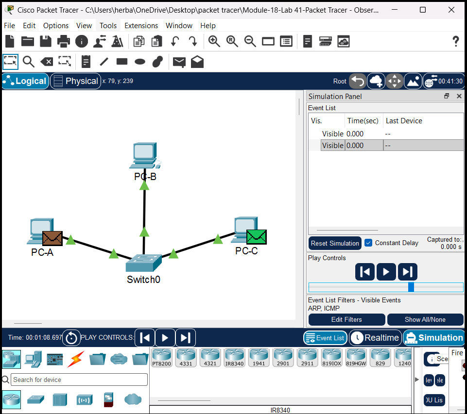

## Overview

Explore the movement of traffic through a small switched Ethernet LAN. Build a topology with three PCs and a Cisco 2960 switch, generate ARP and ICMP traffic, and use Simulation Mode to observe how address resolution affects subsequent pings.

<!--more-->

---

## Preconditions

---

## Skills Practiced

- Construct and cable a three-host switched LAN
- Assign IPv4 addresses within a common /24 network
- Distinguish ARP broadcast traffic from ICMP echo traffic
- Inspect ARP caches and compare simulation reset with device power cycling

---

## Completed Lab Documentation


> * **Completed Lab:** [View LAB PDF]({{ page.completed_lab | relative_url }})


---

## Key Observations

An initial ping may require ARP to resolve the destination MAC address. Simulation resets do not necessarily clear learned dynamic tables, so later traffic can look different from the first exchange.

### Activity Focus

1. Build a 2960 switch topology with three hosts and observe link status.
2. Configure PC-A, PC-B, and PC-C on the 192.168.1.0/24 LAN.
3. Use a Simple PDU from PC-A to PC-C to examine ARP and ICMP events.
4. Inspect ARP tables using the Packet Tracer inspection tool and `arp -a`.

### Notes

This lab is currently in progress. Observations above describe the concepts and intended investigation, not verified completion results. Add screenshots, your own findings, and any corrections after finishing the activity.

---

## Validation

Confirm the three hosts share the intended subnet, the Ethernet links are active, and the ARP table contains the expected neighbor after traffic is generated.

---

## Related Exercises

- Ethernet switching
- ARP address resolution
- ICMP and network diagnostics

---
---
---

## 🔗 Navigation

* [Home](/)
* [Network+ Portfolio](/network-portfolio/)
  * **[FORMATIVE MODULES](/network-portfolio/formative-modules/)**
  * [Videos](/network-portfolio/videos/)
  * [Study Diagrams](/network-portfolio/study-diagrams/)
* [Trading+](/trading/)
* [Bible Study](/bible-study/)
* [About the Portfolio](/about/)

---
---
---
