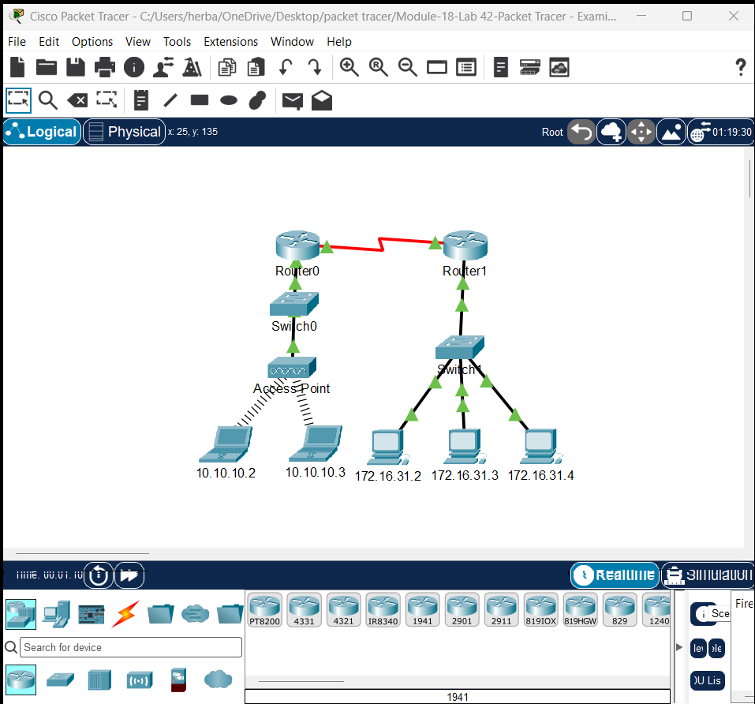

## Overview

Investigate how ARP resolves IPv4 next-hop addresses and how switches learn source MAC addresses. Compare local-LAN communication with traffic destined for a remote network, using Packet Tracer PDU inspection and device tables.

<!--more-->

---

## Preconditions

---

## Skills Practiced

- Trace an ARP request and reply in Simulation Mode
- Compare host ARP caches with switch MAC address tables
- Recognize the Ethernet broadcast destination used by ARP requests
- Explain why remote traffic resolves the default gateway rather than the remote host

---

## Completed Lab Documentation


**Completed Lab:** [View PDF]({{ page.completed_lab| relative_url }})


---

## Key Observations

ARP maps a local next-hop IPv4 address to a MAC address; a switch MAC table maps observed MAC addresses to switch ports. These tables answer different questions and are learned in different ways.

### Activity Focus

1. Clear a host ARP cache and generate a local ping to observe the initial broadcast.
2. Inspect the switch forwarding behavior and learned MAC addresses.
3. Generate traffic on both LANs to examine MAC address table entries.
4. Trace an ARP request when a host communicates with a remote IPv4 network.

### Notes

This lab is currently in progress. Observations above describe the concepts and intended investigation, not verified completion results. Add screenshots, your own findings, and any corrections after finishing the activity.

---

## Validation

Use `arp -a`, `show mac-address-table`, and `show arp` to compare learned entries with the addressing table and selected PDUs.

---

## Related Exercises

- Layer 2 switching
- Default gateway operation
- IPv4 routing

---
---
---

## 🔗 Navigation

* [Home](/)
* [Network+ Portfolio](/network-portfolio/)
  * **[FORMATIVE MODULES](/network-portfolio/formative-modules/)**
  * [Videos](/network-portfolio/videos/)
  * [Study Diagrams](/network-portfolio/study-diagrams/)
* [Trading+](/trading/)
* [Bible Study](/bible-study/)
* [About the Portfolio](/about/)

---
---
---
