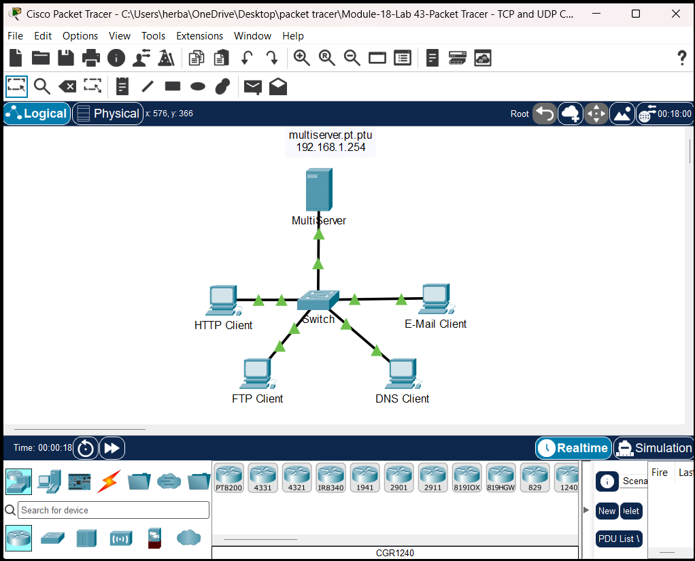

## Overview

Use Packet Tracer Simulation Mode to observe simultaneous application traffic and compare TCP and UDP at the transport layer. Generate HTTP, FTP, DNS, and email exchanges, then inspect ports, TCP flags, sequence and acknowledgement numbers, and UDP datagrams.

<!--more-->

---

## Preconditions

---

## Skills Practiced

- Generate several application flows and observe multiplexing
- Interpret source and destination port numbers
- Inspect TCP connection establishment and reliability fields
- Contrast TCP header information with UDP header information
- Connect common application services to their transport protocols

---

## Video Walkthrough

This lab is recommended for a narrated Packet Tracer walkthrough. Add the YouTube ID after recording and publishing.


<iframe width="560" height="315" src="https://www.youtube.com/embed/{{ page.video_id }}" title="{{ page.title }}" frameborder="0" allowfullscreen></iframe>


---

## Completed Lab Documentation


- [View completed lab PDF]({{ page.completed_lab }})


<!-- Add the completed PDF asset path after the assignment is finished and exported. -->

---

## Key Observations

Transport-layer port numbers identify application conversations. TCP provides connection-oriented delivery with sequence and acknowledgement fields, while UDP has a smaller, connectionless header without those TCP reliability mechanisms.

### Activity Focus

1. Prepare client traffic for HTTP, FTP, DNS, and email against MultiServer.
2. Follow multiplexed PDUs as they move through the network.
3. Filter HTTP and FTP traffic to examine TCP segments and flags.
4. Inspect DNS over UDP and email exchanges involving SMTP and POP3.

### Notes

This lab is currently in progress. Observations above describe the concepts and intended investigation, not verified completion results. Add screenshots, your own findings, and any corrections after finishing the activity.

---

## Validation

Verify the observed PDU types and identify source/destination ports, TCP flags, and relevant application-layer protocol information in the simulation.

---

## Related Exercises

- OSI transport layer
- Application protocols
- TCP three-way handshake

---
---
---

## 🔗 Navigation

* [Home](/)
* [Network+ Portfolio](/network-portfolio/)
  * **[FORMATIVE MODULES](/network-portfolio/formative-modules/)**
  * [Video Walkthroughs](/network-portfolio/videos/)
  * [Study Diagrams](/network-portfolio/study-diagrams/)
* [Trading+](/trading/)
* [Bible Study](/bible-study/)
* [About the Portfolio](/about/)

---
---
---
