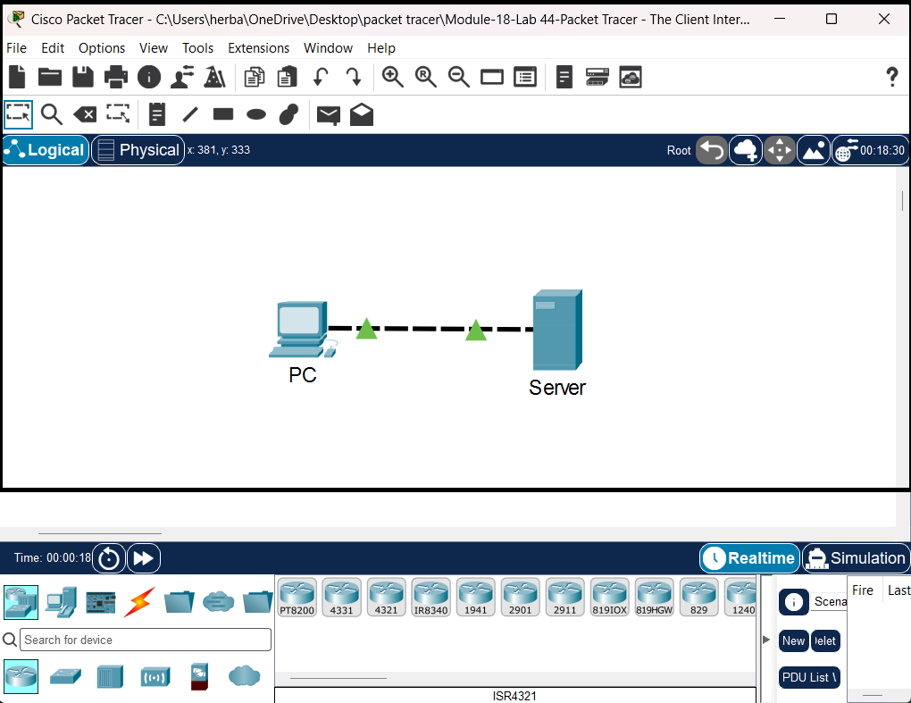

## Overview

Follow a web request from a simulated PC to a server that provides DNS and HTTP services. Observe how the client resolves a hostname, requests a web page, receives the response, and acknowledges the transferred data.

<!--more-->

---

## Preconditions

---

## Skills Practiced

- Trace the sequence of DNS and HTTP events
- Interpret client/server interactions in Simulation Mode
- Use PDU Information to inspect OSI-layer processing
- Relate hostname resolution to subsequent web traffic

---

## Lab Documentation

This activity is being documented as a written lab. A video is not currently planned; the optional embed is retained for consistency with the portfolio template.


<iframe width="560" height="315" src="https://www.youtube.com/embed/{{ page.video_id }}" title="{{ page.title }}" frameborder="0" allowfullscreen></iframe>


---

## Completed Lab Documentation


- [View completed lab PDF]({{ page.completed_lab }})


<!-- Add the completed PDF asset path after the assignment is finished and exported. -->

---

## Key Observations

A web request by hostname depends on name resolution before the client can communicate with the server by IP address. Simulation Mode makes these separate application steps visible.

### Activity Focus

1. Enable Simulation Mode and filter DNS and HTTP events.
2. Request `www.example.com` from the simulated client browser.
3. Follow the name-resolution and page-delivery event sequence.
4. Inspect individual PDU information windows and their OSI-layer descriptions.

### Notes

This lab is currently in progress. Observations above describe the concepts and intended investigation, not verified completion results. Add screenshots, your own findings, and any corrections after finishing the activity.

---

## Validation

Confirm the requested web page appears and inspect the DNS and HTTP events that lead to the response.

---

## Related Exercises

- DNS fundamentals
- HTTP client/server model
- OSI encapsulation

---
---
---

## 🔗 Navigation

* [Home](/)
* [Network+ Portfolio](/network-portfolio/)
  * **[FORMATIVE MODULES](/network-portfolio/formative-modules/)**
  * [Video Walkthroughs](/network-portfolio/videos/)
  * [Study Diagrams](/network-portfolio/study-diagrams/)
* [Trading+](/trading/)
* [Bible Study](/bible-study/)
* [About the Portfolio](/about/)

---
---
---
