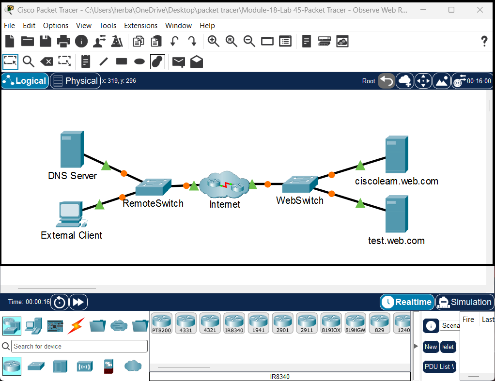

## Overview

Explore the network exchanges behind a web page request. Verify hostname resolution and connectivity, compare server-side HTML with the client browser display, and use a Complex PDU to observe HTTP traffic over TCP.

<!--more-->

---

## Preconditions

---

## Skills Practiced

- Check DNS resolution and reachability using ping
- Compare an HTTP server HTML file with the browser rendering
- Create a Complex PDU for HTTP traffic
- Observe TCP connection setup and acknowledgements during web communication

---

## Completed Lab Documentation


- Note: [Completed Lab PDF may be available upon request]


---

## Key Observations

The browser display comes from content hosted by the server, while TCP exchanges support the underlying HTTP transfer. PDU inspection reveals more network events than the single user action of opening a page.

### Activity Focus

1. Ping `ciscolearn.web.com` and note the resolved server address.
2. Open the site in the simulated client browser.
3. Compare the displayed page with the server’s `index.html`.
4. Create a periodic HTTP Complex PDU and inspect the TCP/HTTP event sequence.

### Notes

This lab is currently in progress. Observations above describe the concepts and intended investigation, not verified completion results. Add screenshots, your own findings, and any corrections after finishing the activity.

---

## Validation

Verify hostname resolution, browser access, HTML correspondence, and the HTTP/TCP events produced by the Complex PDU.

---

## Related Exercises

- HTTP over TCP
- DNS name resolution
- Web server fundamentals

---
---
---

## 🔗 Navigation

* [Home](/)
* [Network+ Portfolio](/network-portfolio/)
  * **[FORMATIVE MODULES](/network-portfolio/formative-modules/)**
  * [Video Walkthroughs](/network-portfolio/videos/)
  * [Study Diagrams](/network-portfolio/study-diagrams/)
* [Trading+](/trading/)
* [Bible Study](/bible-study/)
* [About the Portfolio](/about/)

---
---
---
