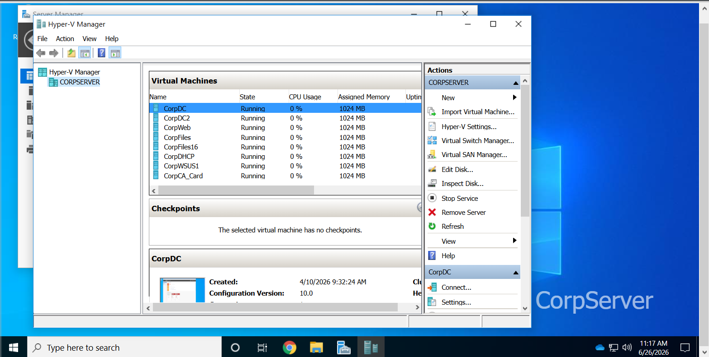

## Overview

This guided walkthrough demonstrates how to create both primary and secondary forward lookup zones using Windows Server DNS Manager.

<!--more-->

The exercise introduces standard DNS zones, zone transfers, and the relationship between primary and secondary DNS servers in an enterprise environment.

---

## Preconditions

The DNS server infrastructure has already been installed and configured.

Use the lab instructions or environment image as a reference for:

- Zone name
- Master DNS server
- Zone transfer settings



---

## Video Walkthrough

Watch the complete walkthrough:

<a href="{{ page.video_url }}" target="_blank" rel="noopener noreferrer">
  
</a>

---

> **Portfolio Note**
>
> This page documents my personal learning journey through networking, systems administration, and cybersecurity. The accompanying walkthrough demonstrates concepts and techniques using a hands-on lab environment for educational purposes.

---

# Lab 6.5.12 — Create Primary and Secondary DNS Zones

> Companion study guide for my TestOut lab walkthrough. This is an independently written learning resource, **not** a reproduction of TestOut's proprietary lab instructions. Exact screens, options and required settings depend on the lab version.

## Learning objectives

- Explain the purpose of create primary and secondary dns zones in network operations.
- Apply the relevant configuration or analysis workflow in an authorized lab.
- Verify results using observable evidence rather than assumptions.
- Troubleshoot a failed or incomplete configuration safely.

## Core concepts

**Focus:** Windows Server DNS. Connect this lab to least privilege, change control, documentation, and repeatable verification where applicable.

## Suggested hands-on workflow

1. **Record the baseline.** Note the device, interfaces, addressing, current configuration, and intended outcome.
2. **Plan the change.** Identify dependencies, permissions, and a rollback approach.
3. **Perform the lab task.** Create a primary zone on the authoritative server; permit transfers only to an approved secondary; create a secondary zone and verify SOA/NS and replication.
4. **Verify.** Check the resulting configuration or packet evidence and test the expected behavior.
5. **Document.** Capture redacted screenshots/output, observations, issues, and resolution.
6. **Restore or save.** Save only approved changes; otherwise revert the lab environment.

## Example commands or filters

The following are **reference examples**, not guaranteed exact commands for this TestOut simulation. Run only those supported by your lab platform and replace placeholders with authorized values.

```text
Get-DnsServerZone
Get-DnsServerResourceRecord -ZoneName "example.internal"
```

## Verification checklist

- [ ] Initial state and desired result documented
- [ ] Configuration or capture completed without unintended side effects
- [ ] Expected behavior confirmed with an independent check
- [ ] Unexpected results investigated and explained
- [ ] Screenshots or output sanitized before publication
- [ ] Final state and lessons learned recorded

## Troubleshooting prompts

- Is the correct device, adapter, scope, interface, zone, or traffic stream selected?
- Are permissions, connectivity, and prerequisite services available?
- Is a policy override, firewall, VLAN, or upstream dependency affecting results?
- What single observation would distinguish a configuration issue from a connectivity issue?

## Security and operational notes

Zone transfers should be restricted; avoid exposing internal zone data.


---
---
---

## 🔗 Navigation

* [Home](/)
* [Network+ Portfolio](/network-portfolio/)
  * [Formative Modules](/network-portfolio/formative-modules/)
  * **[VIDEOS](/network-portfolio/videos/)**
  * [Study Diagrams](/network-portfolio/study-diagrams/)
* [Trading+](/trading/)
* [Bible Study](/bible-study/)
* [About the Portfolio](/about/)

---
---
---